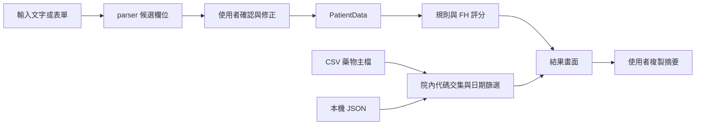

# 架構與資料流

## 模組

| 模組 | 責任 |
| --- | --- |
| `main.py` | 初始化可用的 Tcl/Tk 並啟動 GUI；`--smoke-test` 用於隔離驗證 |
| `statin_nhi/models.py` | `PatientData`、日期與衍生資料 |
| `statin_nhi/parser.py` | 從輸入文字提出欄位候選值與複核提示 |
| `statin_nhi/rules.py` | 風險分級、血脂目標與 CKD 證據判定 |
| `statin_nhi/fh.py` | 手動證據與 LDL-C 的 FH 評分 |
| `statin_nhi/medications.py` | CSV 載入、生效日、院內設定與公告提醒偏好 |
| `statin_nhi/ui.py` | 輸入、人工確認、彈出視窗、判讀與剪貼簿 |
| `statin_nhi/smoke.py` | 使用暫存設定的原始碼／EXE GUI 冒煙測試 |
| `Ref/` | 程式主檔及官方規定附件快照 |

## 一次判讀

parser 結果不能視為確診。`evaluate_all()` 現在僅回傳新制規則結果；舊設計草稿的 TG／舊制輸出未啟用。藥物清單只與院內設定及日期比對，不是完整個別用藥給付引擎。

## 檔案位置

原始碼執行以專案根目錄為設定位置；凍結 EXE 以執行檔所在資料夾為設定位置。CSV 與圖示由 PyInstaller 內嵌，使用 `_MEIPASS` 讀取；設定寫入位置不使用 `_MEIPASS`。

設定以 `.tmp` 寫入後替換原檔。格式錯誤時拒絕覆寫，避免藥物清單或提醒偏好遺失。此流程不是多程序同步鎖；請避免同時執行多個實例編輯同一個設定檔。

臨床輸入不會由應用程式自動保存。設定格式與舊提醒檔遷移詳見 [PRIVACY.md](PRIVACY.md)。
